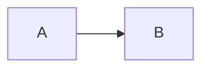

# {도메인 한글명} ({domain})

> 이 도메인이 무엇을 책임지는지 한 줄.

**소유 경로**
- `src/features/{domain}/`
- `src/app/{route}/`

---

## 1. 데이터 모델

**타입 이름과 관계만** 적는다. 필드는 적지 않는다 — 타입 정의가 진실이다.

- `Xxx` — 무엇을 나타내는가 · 누구와 연결되는가 → `src/types/{domain}.ts`

## 2. 핵심 플로우

mermaid 1~2개. 코드를 안 읽고도 흐름의 큰 줄기를 잡을 수 있게.

## 3. 불변식

**깨지면 버그인 규칙.** 이 절이 이 문서의 존재 이유 절반이다.

- (예) 초안(`draft: true`) 글은 목록·sitemap·RSS 어디에도 나오지 않는다
- (예) 글 slug는 한 번 공개하면 바꾸지 않는다 — 바꾸면 외부 링크가 깨진다

## 4. 함정

**실제로 물렸던 것만.** 상상한 위험이 아니라 겪은 것.

- (예) frontmatter 날짜를 `new Date()`로 파싱하면 빌드 환경 타임존에 따라 하루가 밀린다

## 5. 확장 포인트

갈아끼우라고 만든 자리 — env, 설정 상수, 교체 전제 인터페이스.

| 위치 / 토큰 | 의도 |
|---|---|
|  |  |

## 6. 관련 ADR

- `ADR-NNNN` — 제목 (실제 파일 링크로 교체. 관련 ADR이 없으면 이 절을 통째로 지운다)

## 7. 여기 없는 것

이 도메인에 대해 **어디를 봐야 하는지**만 남긴다.

- 타입 정의 → `src/types/{domain}.ts`
- 코딩 규칙 → `AGENTS.md`
