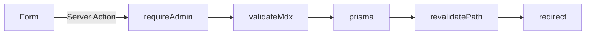

# 관리자 (admin)

> 글·프로젝트·About을 작성·수정·삭제하고 공개 상태를 바꾼다.

**소유 경로**
- `src/app/(admin)/admin/`
- `src/auth.ts`

---

## 1. 데이터 모델

- `Post`, `Project`, `Page`, `Series`(Post N:1), `PostView`(Post 1:N, 일별 조회수) → `prisma/schema.prisma` ([ADR-0002](../adr/0002-content-data-model.md))

## 2. 핵심 플로우

## 3. 불변식

- 데이터를 읽는 모든 admin page, 모든 Server Action, 관리자 Route Handler는 첫 줄에서 `requireAdmin()`을 호출한다. layout 검사만 믿지 않는다.
- 허용 목록 밖 컴포넌트나 컴파일 안 되는 MDX는 저장되지 않는다(`validateMdx`).
- 공개(PUBLISHED)된 항목의 slug는 바뀌지 않는다. 폼은 readOnly, action은 기존 slug를 유지한다.
- PUBLISHED면 `publishedAt`이 있다. 시리즈에 속한 글(`seriesId`)은 `seriesOrder`도 있다. 둘 다 DB CHECK 제약으로 강제한다.
- 글이 연결된 시리즈는 삭제되지 않는다(FK Restrict). `SetNull`로 두면 `seriesOrder`만 남아 위 CHECK에 걸린다.
- 업로드 이미지 키는 `{yyyy}/{mm}/{uuid}.{ext}`이고 한 번 올린 키의 내용은 바뀌지 않는다. `/media/*`는 이 패턴 밖의 키를 404로 막고 `immutable`로 캐시한다 ([ADR-0007](../adr/0007-minio-image-upload.md)).
- `publishedAt`은 날짜 단위(UTC 자정)다. 공개로 저장할 때 비어 있으면 KST 기준 오늘이 들어간다. 같은 날짜는 `createdAt`으로 정렬한다.

## 4. 함정

- layout과 page는 병렬로 렌더링된다. layout의 `requireAdmin()`이 page의 DB 쿼리를 막지 않는다.
  그래서 빌드 prerender 때 admin 페이지가 DB 연결을 기다리다 60초 타임아웃으로 빌드가 멈췄다 → layout에 `dynamic = "force-dynamic"`.
- 저장 실패 시 폼이 비워졌다: React 19는 form action이 끝나면 비제어 입력을 defaultValue로 되돌린다. 실패 응답에 `values`를 담아 defaultValue로 다시 쓴다.
- `trailingSlash: true` 때문에 `/api/auth/*`는 308로 슬래시가 붙는다. GitHub OAuth App 콜백은 슬래시 없이 등록해도 된다.

- CHECK 제약(`Post_published_has_date`, `Project_published_has_date`, `Post_series_has_order`)은 Prisma 스키마로 표현할 수 없어 마이그레이션 SQL(`20260930120000_series_views_categories`)에만 있다. 스키마에는 보이지 않는다.
- `(seriesId, seriesOrder)` 유니크 위반도 P2002라 slug 중복과 구분되지 않는다. 그래서 `savePost`가 저장 전에 순서 충돌을 먼저 확인한다.

## 5. 확장 포인트

| 위치 / 토큰 | 의도 |
|---|---|
| `ADMIN_GITHUB_ID` | 관리자 GitHub 숫자 id |
| `form.ts`의 `readContentFields` | Post·Project 공통 입력 검증 |
| `storage.ts`의 `IMAGE_TYPES` | 업로드 허용 이미지 형식 (SVG 제외) |

## 6. 관련 ADR

- [ADR-0005](../adr/0005-authjs-github-allowlist.md) — Auth.js + GitHub allowlist
- [ADR-0003](../adr/0003-runtime-mdx-rendering.md) — MDX 허용 목록
- [ADR-0007](../adr/0007-minio-image-upload.md) — MinIO 이미지 업로드

## 7. 여기 없는 것

- 본문 렌더링 → [mdx.md](mdx.md)
- 코딩 규칙 → `AGENTS.md`
