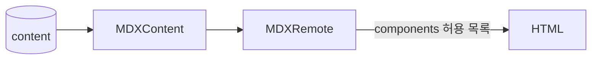

# 본문 렌더링 (mdx)

> DB에 저장된 MDX 본문을 공개 페이지에서 HTML로 렌더링한다.

**소유 경로**
- `src/components/mdx/`

---

## 1. 데이터 모델

- `Post.content`, `Project.content`, `Page.content` — MDX 원문 문자열 → `prisma/schema.prisma`

## 2. 핵심 플로우

## 3. 불변식

- 본문에서 쓸 수 있는 JSX 컴포넌트는 `MDXContent.tsx`의 `allowedComponents`뿐이다. 본문에 `import`/`export`를 쓰지 않는다.
- 공개 페이지는 `status = PUBLISHED`인 행만 렌더링한다.
- slug는 공개 URL이다. 한 번 공개하면 바꾸지 않는다.

## 4. 함정

- 기존 MDX 파일 본문의 `import` 줄은 런타임 컴파일에서 쓸 수 없다. 이관 스크립트(`scripts/import-mdx.ts`)가 제거한다.
- `blockJS` 기본값 때문에 본문의 `{표현식}`은 조용히 사라진다. JSX 속성은 문자열(`className='mb-4'`)로만 쓴다.

## 5. 확장 포인트

| 위치 / 토큰 | 의도 |
|---|---|
| `MDXContent.tsx`의 `allowedComponents` | 본문에서 쓸 컴포넌트 추가 (저장 검증도 이 목록을 쓴다) |
| `components.tsx`의 `mdxComponents` | 마크다운 요소 스타일 |

## 6. 관련 ADR

- [ADR-0003](../adr/0003-runtime-mdx-rendering.md) — 런타임 MDX 렌더링과 컴포넌트 허용 목록
- [ADR-0004](../adr/0004-dynamic-public-rendering.md) — 공개 페이지 요청 시 렌더링

## 7. 여기 없는 것

- 조회 쿼리 → `src/lib/posts.ts`, `src/lib/projects.ts`
- 코딩 규칙 → `AGENTS.md`
